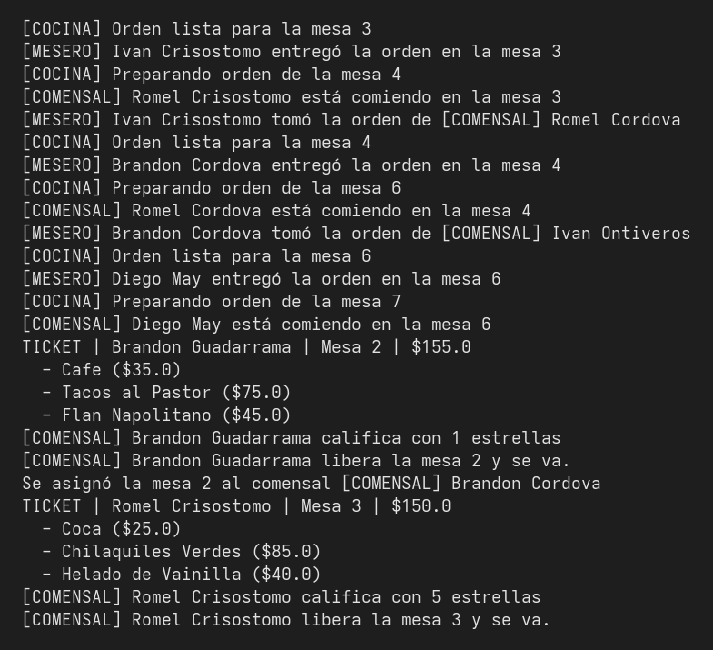
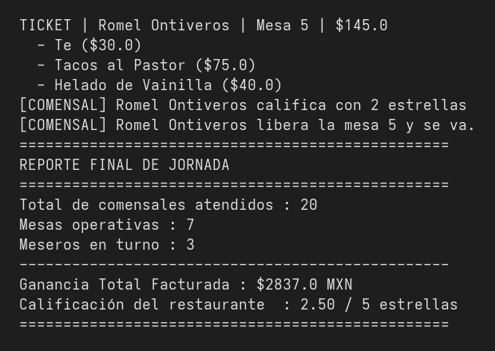

# Restaurante Los Pooderosos

**Universidad Nacional Autónoma de México**<br>
Programación Orientada a Objetos<br>
Grupo 03

**Profesor:** Diego Javier Santamaría Nájera

## Integrantes de equipo

- Guadarrama Climaco Ivan Alexei
- Maza Córdova Brandon de Jesús
- Ontiveros Mota Romel
- Rodríguez May Diego Antonio
- Soriano Crisóstomo Aldo Rodrigo

## Descripción

Simulación de un restaurante con hilos en Java. Llegan 20 comensales, hay 7
mesas y 3 meseros, y todo pasa al mismo tiempo. Al final se imprime cuánto
se ganó y qué calificación sacó el restaurante.

## Funcionamiento

Cada comensal realiza lo siguiente, en orden:

1. Llega y espera un momento (300 a 600 ms).
2. Pide una mesa. Si no hay, se queda esperando hasta que se libere una.
3. Elige comida y un mesero le toma la orden (500 ms).
4. La cocina la prepara (800 ms, de una en una).
5. Un mesero lleva la comida y el comensal come (1 a 2 s).
6. Pide la cuenta y un mesero le cobra (200 ms).
7. Después de pagar, califica (0 a 5 estrellas), libera la mesa y se va.

## Ejecución

Desde la carpeta `src`:

```bash
javac *.java
java mainRestaurante
```

## Salida en consola

Fragmento de la simulación:



Último ticket y reporte final de jornada:



## Explicación por clase

- **`mainRestaurante`**: es la clase principal. Crea las mesas, los meseros y
  los comensales, guarda la cola de acciones, suma el dinero y las
  calificaciones, e imprime el reporte final.
- **`Persona`**: clase padre de `Comensal` y `Mesero`. Les da un nombre al
  azar. Extiende `Thread`, para que cada persona sea un hilo.
- **`Comensal`**: es el cliente. Su `run()` es el recorrido descrito
  anteriormente.
- **`Mesero`**: es el trabajador. Saca tareas de la cola de prioridad y realiza
  su acción respectiva.
- **`Cocina`**: tiene un solo método, `preparar()`, y es `synchronized`.
- **`Mesa`**: tiene un ID (1 a 7) y un estado (libre u ocupada).
- **`Orden`**: junta al comensal, la mesa y los alimentos, y calcula el total.
- **`Alimento`, `Bebida`, `Comida`, `Postre`**: el menú. `Alimento` es el padre
  con nombre y precio; los otros tres escogen un producto al azar de su lista
  (5 por categoría).

## Funciones principales

### Cola de prioridad

Los meseros no están asignados a nadie. Todos sacan tareas de una misma
`PriorityQueue`. Hay tres tipos de acción:

| Prioridad | Acción        |
| :-------: | ------------- |
|     1     | Servir comida |
|     2     | Tomar orden   |
|     3     | Cobrar        |

Servir va primero para que la comida no se enfríe, y tomar orden va antes que
cobrar para que los pedidos lleguen pronto a la cocina. El mesero que cobra no
es necesariamente el que tomó la orden, y por eso la `Orden` guarda la mesa:
así la comida llega a la mesa correcta.

### Mesas con `wait` / `notifyAll`

Hay 7 objetos `Mesa` y un contador `mesasLibres`. Si el contador está en 0, el
comensal hace `wait()` (se duerme). Cuando alguien se va, libera su mesa, sube
el contador y hace `notifyAll()` para despertar a los que esperan. De esta
manera logramos que nunca haya más de 7 mesas ocupadas (las únicas
disponibles).

### Cocina con `synchronized`

Solo entra un mesero a la vez a `preparar()`. Si dos meseros llegan juntos, uno
espera. El mesero permanece en la cocina hasta que la orden está lista y
después agrega a la cola la acción de servirla.

### Acumuladores seguros

Los métodos que suman ganancia, cobros y calificaciones son `synchronized`. Si
no lo fueran, dos hilos podrían sumar al mismo tiempo y perderse un dato.

### Comunicación entre comensal y meseros

El comensal tiene `servido` y `pagado`. El mesero los modifica cuando entrega y
cuando cobra, y el comensal verifica (`true` o `false`) en un ciclo con
`sleep(20)`. Los getters y setters son `synchronized` para que el cambio se vea
entre hilos.

### Calificación

Es un número entero al azar de 0 a 5.

### Cierre

Los meseros terminan cuando ya se cobraron los 20 comensales. El `main` espera
a todos con `join()` y luego imprime el reporte.

## Conceptos investigados

La investigación de estos conceptos se realizó con apoyo de Claude (Anthropic).

- **`synchronized`**: en un método, deja entrar solo a un hilo a la vez por
  objeto. Los demás se forman. Evita las condiciones de carrera (dos hilos
  modificando lo mismo a la vez).
- **`wait()`**: el hilo se duerme y suelta el candado del `synchronized` hasta
  que otro lo despierte. Solo se puede llamar dentro de un bloque o método
  `synchronized`.
- **`notifyAll()`**: despierta a todos los hilos que están en `wait()` sobre
  ese objeto. Se prefiere sobre `notify()` (despierta solo a uno) porque aquí
  todos esperan por lo mismo y cada uno revisa su condición.
- **Deadlock (interbloqueo)**: dos hilos esperándose para siempre. Aquí no pasa
  porque, cuando un hilo toma dos candados (al asignar o liberar una mesa),
  siempre lo hace en el mismo orden: primero el del restaurante y después el de
  la `Mesa`. Así no se forma una espera circular.
- **Starvation (inanición)**: que a un hilo nunca le toque. En las mesas puede
  que no se respete el orden exacto de llegada, y en la cola de prioridad un
  cobro puede posponerse mientras haya acciones más urgentes. Aun así todos
  terminan, porque los comensales son 20 y las acciones pendientes se acaban.
- **`PriorityQueue`**: cola que saca primero el elemento "menor" según
  `compareTo`. Por eso `Accion` implementa `Comparable` y compara por
  prioridad. No es segura para hilos, por eso solo se toca desde métodos
  `synchronized`.
